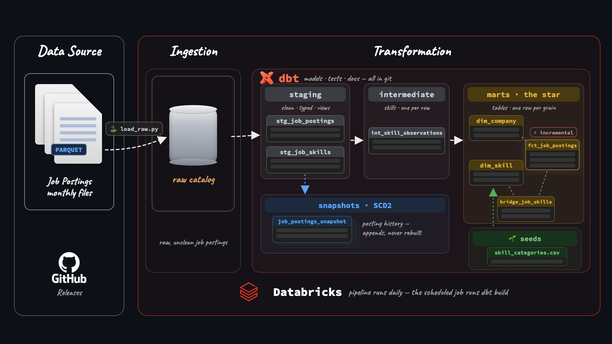
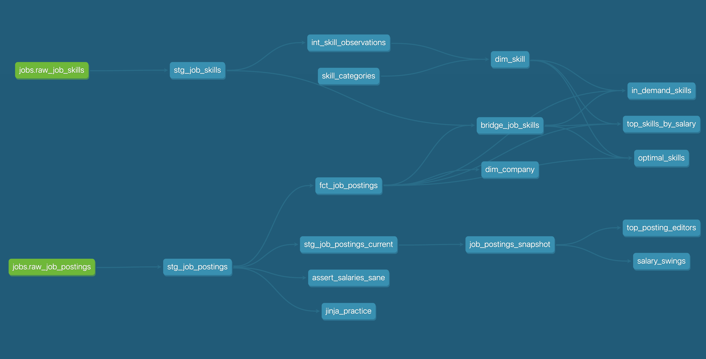

# Production Job Postings Pipeline (v2) - dbt + Databricks

Built a production-grade dbt pipeline on **Databricks**, processing *843,097* raw job-posting records through a monthly automated workflow.

## What v2 delivers:

- **Medallion architecture to star schema**: Transforms raw data into tested, analytics-ready models, with *491,140* jobs at a clearly defined grain.
- **SCD Type 2 salary history**: Preserves a year of salary changes across *504,591* historical version records.
- **Incremental processing & orchestration**: Built incremental dbt models and automated nightly execution with Databricks Jobs.

## From v1 to v2

[**Version 1**](https://github.com/htikehsumyat/dbt-duckdb-pipeline) established the foundations using DuckDB and GitHub Actions. **Version 2** takes the same dataset into a real warehouse with Databricks, historical tracking through SCD2, incremental transformations, and scheduled orchestration.

**The goal**: move beyond a working data pipeline and build a warehouse that can maintain itself, preserve historical changes, and support reliable analytics at scale.

## What I Built

| Component | Implementation | Where to Find It |
|---|---|---|
| **Star Schema** | Fact, dimension, and bridge tables on a declared grain | [`analytics/models/marts/`](analytics/models/marts/) |
| **SCD Type 2 Snapshots** | One year of salary history, including historical backfills | [`analytics/snapshots/`](analytics/snapshots/) + [`scripts/`](scripts/) |
| **Incremental Fact Model** | MERGE on `job_id`, processing only new data | [`fct_job_postings.sql`](analytics/models/marts/fct_job_postings.sql) |
| **Macros** | Custom salary parser and overridden dbt built-in macro | [`analytics/macros/`](analytics/macros/) |
| **Data Quality Tests** | Generic, singular, and custom generic tests | [`analytics/tests/`](analytics/tests/) + properties YAML files |
| **Environments** | Separate `dev` and `prod` catalogs; local development and job-based production execution | Unity Catalog: `dev` + `prod` |
| **Automated Orchestration** | Scheduled Databricks Job | Databricks → Jobs & Pipelines |
| **Analyses** | SQL analyses documenting business questions alongside the models that answer them | [`analytics/analyses/`](analytics/analyses/) |

## ⚙️ The dbt Pipeline

Raw scrapes flow through the medallion layers — raw → staging → intermediate → the star-schema marts — while snapshots capture history off staging. The lineage graph below is every model dbt builds:

## dbt Features in Practice

| dbt Feature | How I Used It |
|---|---|
| **Declared Sources** | Used `source('jobs', 'raw_job_postings')` to reference raw data without hardcoding paths. |
| **Jinja Loops** | Generated benefit flags dynamically with a Jinja loop, making new flags easy to add in one place. |
| **Custom Macros** | Built `parse_salary()` to centralize salary parsing logic and reuse it across four models. |
| **dbt Packages** | Used `dbt_utils.get_column_values()` to dynamically populate the roles loop from warehouse data. |
| **Macro Overrides** | Overrode `generate_schema_name` to control schema placement based on the model folder structure. |
| **Seeds** | Version-controlled the skill taxonomy as reference data using dbt seeds. |
| **Test-Driven Cleaning** | Used `not_null` tests to identify 6,255 postings with missing IDs; excluded them after investigating and documenting the decision. |
| **Singular & Custom Tests** | Built `assert_salaries_sane` to catch 27 implausible salary ceilings (up to 1M) that standard schema tests could not detect. |
| **SCD Type 2 Snapshots** | Used the check strategy across 13 content columns, with `searched_at` as the snapshot timestamp. |
| **Incremental Models** | Used `merge` on `job_id`, combining `is_incremental()` with a `search_date` high-water mark to process new data. |
| **Environment Management** | Configured separate environments: `dev` uses the local profile, while `prod` runs through the scheduled Databricks Job. |

## 🚀 Production

## Databricks Infrastructure & Orchestration

Databricks manages the warehouse runtime, compute, storage, and orchestration in one platform.

- **Environment Separation:** Separate `dev` and `prod` catalogs in Unity Catalog. Local development writes to `dev`, while the scheduled Databricks Job publishes the same models to `prod`.

- **Automated Pipeline Execution:** A scheduled Databricks Job runs the full pipeline in sequence: `load_raw` (ingestion notebook), `dbt deps`, `dbt debug`, and `dbt build`. The job pulls the project directly from GitHub.

- **Temporary Credentials:** The job generates a temporary-credentials dbt profile using the attached SQL warehouse and revokes the credentials after execution. No static tokens are stored in the repository or CI configuration.

- **BI Connectivity:** The production SQL warehouse serves as the access point for downstream analytics. SQL Editor, Excel, Power BI, and Tableau can query the `prod` catalog directly.

## 📸 Snapshots

## Historical Salary Tracking (SCD Type 2)

The marts retain the latest version of each job posting. The snapshot table preserves its history using SCD Type 2, tracking changes across 13 monitored columns.

- **Historical Coverage:** 504,591 snapshot rows across 491,140 jobs, including 10,187 jobs with actual change history.
- **Salary Changes:** 2,756 postings had salary changes between scrapes.
- **Analysis on Top of Snapshots:** `top_posting_editors.sql` identifies Meta as the most frequent editor, with 415 edited postings. `salary_swings.sql` highlights suspicious salary changes, including one posting that jumped from $60K to $1M — a change that would be invisible in a latest-state-only model.

## 📖 Docs

Structure, tests, and column descriptions were written along the way — the docs site is a rendering of work already done:

→ **[htikehsumyat.github.io/dbt-databricks-pipeline](https://htikehsumyat.github.io/dbt-databricks-pipeline/)**

The site shows:

- The full lineage graph (raw → staging → intermediate → the star → snapshot)
- Model and column descriptions from the YAMLs
- Which columns carry tests

## The Dataset
A year of real job postings (Data Engineer, Data Analyst, Data Scientist roles) collected by Luke Barousse's datanerd.tech pipeline, July 2025 - June 2026.
